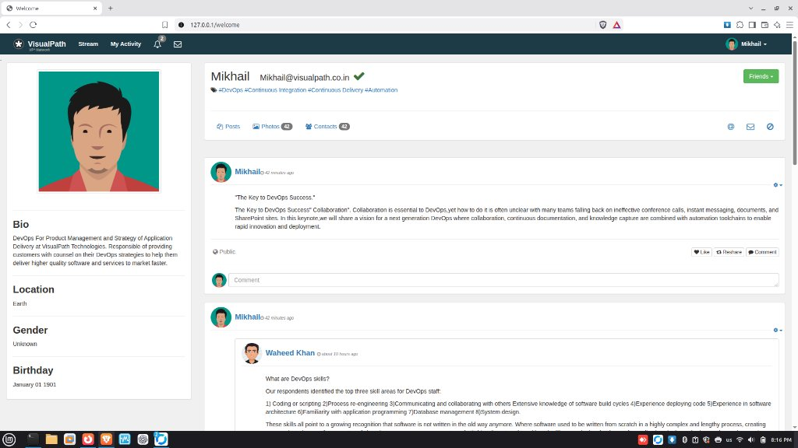

# Enterprise Docker Infrastructure: Hardened, Isolated & Scanned 5-Tier Architecture

[](https://www.docker.com/)
[](https://docs.docker.com/compose/)
[-success.svg)](#-security-hardening-strategy)
[](https://trivy.dev/)
[-orange.svg)](#-security-hardening-strategy)

---

## 📌 Executive Summary

This repository contains a production-ready, highly hardened, and isolated microservices infrastructure built with Docker & Docker Compose for the enterprise **VProfile Web Application** (Senior Academy — Lab 02: Enterprise Docker Infrastructure Security, Vulnerability Scanning & Isolation).

The architecture strictly adheres to enterprise DevSecOps standards, implementing **Defense-in-Depth**, **Dual-Tier Network Isolation**, **Least Privilege Access Control**, **Docker Secrets**, and **Vulnerability & Misconfiguration Scanning via Aqua Security Trivy**.

---

## 🏗️ Architecture & Network Isolation

```
                                  [ Internet / Client ]
                                            │
                                            │ HTTP (Port 80)
                                            ▼
┌─────────────────────────── [ Frontend Network (Bridge) ] ───────────────────────────┐
│                                                                                     │
│    ┌───────────────────────────────────────────────────────────────────────────┐    │
│    │                           NGINX Reverse Proxy                             │    │
│    │             - Non-Root UID 10001 | Port 80 Ingress only                   │    │
│    │             - Reverse proxies traffic to Tomcat Backend                   │    │
│    └─────────────────────────────────────┬─────────────────────────────────────┘    │
│                                          │                                          │
└──────────────────────────────────────────┼──────────────────────────────────────────┘
                                           │ HTTP (Port 8080)
┌──────────────────────────────────────────┼──────────────────────────────────────────┐
│                                          ▼                                          │
│    ┌───────────────────────────────────────────────────────────────────────────┐    │
│    │                         Tomcat Application Server                         │    │
│    │             - Non-Root UID 10001 | Dual Network Gateway                   │    │
│    │             - Runs Spring Boot / Java 11 VProfile App                     │    │
│    └───────────────┬─────────────────────┼─────────────────────┬───────────────┘    │
│                    │                     │                     │                    │
│    ┌───────────────▼───────────┐ ┌───────▼─────────┐ ┌─────────▼──────────┐         │
│    │      MariaDB Database     │ │ Memcached Cache │ │  RabbitMQ Broker   │         │
│    │   - Named Volume: db_data │ │ - Session Store │ │ - Persistent Queue │         │
│    │   - Port: 3306 (internal) │ │ - Port: 11211   │ │ - Port: 5672       │         │
│    └───────────────────────────┘ └─────────────────┘ └────────────────────┘         │
│                                                                                     │
│             [ Backend Network: internal = true (Strict Isolation) ]                 │
│              * No host port bindings * Zero outbound/inbound internet access        │
└─────────────────────────────────────────────────────────────────────────────────────┘
```

### Network Topology:
1. **`frontend` (Bridge Network):**
   - The only network exposed to the outside world via **NGINX Reverse Proxy** on host port `80`.
   - Bridges communication securely between NGINX and Tomcat.
2. **`backend` (Internal Network - `internal: true`):**
   - Fully isolated network with zero external gateway.
   - Houses **MariaDB**, **Memcached**, **RabbitMQ**, and the application layer of **Tomcat**.
   - Backing services expose **zero ports** to the host system and cannot initiate any outgoing connections to the outside internet.

---

## 🛡️ Security Hardening Strategy

| Security Control | Implementation Details | Impact |
| :--- | :--- | :--- |
| **Non-Root Execution** | Custom Dockerfiles create & enforce dedicated unprivileged user `appuser` (`UID:GID 10001:10001`). | Prevents container-breakout attacks from gaining host `root` access. |
| **Capability Dropping** | `cap_drop: [ ALL ]` applied across services. | Strips all Linux kernel privileges (raw sockets, chroot, module loading, ptrace, etc.). |
| **Privilege Escalation Block** | `security_opt: [ "no-new-privileges:true" ]` configured. | Prevents `setuid`/`setgid` binaries from gaining elevated privileges inside containers. |
| **Secrets Management** | Docker Compose Secrets mounted under `/run/secrets/`. | Removes cleartext credentials from environment variables and shell history. |
| **Strict File Permissions** | Local secret files are locked to `chmod 600` and excluded in `.gitignore`. | Host-level credential protection against unauthorized local reading. |
| **Resource Quotas** | Strict `cpus` and `memory` limits defined for every service. | Mitigates Denial-of-Service (DoS) and "noisy neighbor" resource starvation. |
| **Health Checks & Order** | Native `HEALTHCHECK` with `depends_on: condition: service_healthy`. | Eliminates race conditions during startup; services start only when dependencies are fully ready. |

---

## 🔍 Vulnerability Scanning & DevSecOps (Trivy)

To fulfill shift-left security requirements, automated scanning was integrated using **Aqua Security Trivy**:

### 1. Infrastructure-as-Code (IaC) Scan
```bash
docker run --rm -v $(pwd):/work aquasec/trivy:latest config /work
```
* **Result:** `0 CRITICAL`, `0 HIGH` misconfigurations. Dockerfiles and Compose files fully pass security best-practice benchmarks.

### 2. Container Images Scan (CVEs)
- **NGINX (`enterprise-nginx:latest`):** High security posture using a lightweight Alpine base image.
- **Tomcat (`enterprise-tomcat:latest`):** Multi-stage build based on `tomcat:9.0-jre11-temurin-jammy`. Scan identified legacy application-level dependencies (Spring Framework / Jackson).
- **Defense-in-Depth Mitigation:** Because the container runs with `UID 10001`, `cap_drop: ALL`, `no-new-privileges`, and backend services reside in an `internal: true` network, **remote code execution cannot escalate to host compromise or lateral network movement**.

Reports are archived under:
- `docs/iac-security-report.txt`
- `docs/nginx-vuln-report.txt`
- `docs/tomcat-vuln-report.txt`

---

## 📁 Repository Structure

```
enterprise-docker-infrastructure/
├── docker-compose.yml          # Production Compose specification with hardening & health checks
├── .gitignore                  # Prevents accidental commits of secrets, volumes, and temporary files
├── README.md                   # Complete architectural & operational documentation
├── nginx/
│   ├── Dockerfile              # Non-root Alpine NGINX with custom user (UID 10001)
│   └── nginx.conf              # Reverse proxy configuration with /health & /tmp cache redirection
├── tomcat/
│   └── Dockerfile              # Multi-stage Maven build -> Hardened Tomcat 9.0 JRE11 (UID 10001)
├── mariadb/
│   └── init.sql                # Complete VProfile database schema (role, user, user_role)
├── rabbitmq/
│   └── rabbitmq.conf           # Explicit broker configuration with listeners & credentials
├── secrets/                    # Stored with chmod 600 (Ignored by Git)
│   ├── db_root_password.txt
│   ├── db_password.txt
│   └── rmq_password.txt
├── scripts/
│   └── validate.sh             # Automated end-to-end verification and vulnerability scanner
└── docs/
    ├── app-dashboard.jpg       # Live application verification screenshot
    ├── iac-security-report.txt # Trivy IaC configuration audit (0 misconfigurations)
    ├── nginx-vuln-report.txt   # Trivy NGINX image CVE scan report
    └── tomcat-vuln-report.txt  # Trivy Tomcat/App image CVE scan report
```

---

## 🚀 Quick Start Guide

### Prerequisites
- Linux OS (Ubuntu / Linux Mint / Debian / RHEL)
- Docker Engine 24.0+ & Docker Compose V2
- `curl` and `git`

### 1. Configure Local Secrets
Ensure secret files exist and enforce least privilege file permissions:
```bash
chmod 600 secrets/*.txt
```

### 2. Build & Launch the Infrastructure
```bash
docker compose up -d --build
```

### 3. Verify Health & Running Containers
```bash
docker compose ps
```
*All 5 services (`mariadb`, `memcached`, `rabbitmq`, `tomcat`, `nginx`) should transition to `healthy`.*

### 4. Run the Automated Validation Suite
Execute the pre-packaged verification script:
```bash
chmod +x scripts/validate.sh
./scripts/validate.sh
```

### 5. Access the Web Application
Open your browser and navigate to:
```
http://localhost/login
# or
http://127.0.0.1/login
```

To test standard authentication:
- **Default User:** `admin_vp`
- **Default Password:** `admin_vp`

#### 📸 Verified Operational Application (Live Dashboard):
<p align="center">
  
</p>

---

## 🧪 Validation & Acceptance Criteria Matrix

| Criterion | Requirement | Verification Command | Status |
| :--- | :--- | :--- | :--- |
| **AC-01** | Multi-tier Architecture | `docker compose ps` (5 running services) | ✅ Passed |
| **AC-02** | NGINX Reverse Proxy | `curl -I http://localhost/login` returns HTTP `200` | ✅ Passed |
| **AC-03** | Frontend/Backend Isolation | `docker network inspect enterprise-docker-infrastructure_backend` (`internal: true`) | ✅ Passed |
| **AC-04** | Non-Root Tomcat | `docker compose exec tomcat id` -> `uid=10001(appuser)` | ✅ Passed |
| **AC-05** | Non-Root NGINX | `docker compose exec nginx id` -> `uid=10001(appuser)` | ✅ Passed |
| **AC-06** | Database Data Persistence | Named volume `db_data` verified after restart | ✅ Passed |
| **AC-07** | Secrets Management | Credentials mounted at `/run/secrets/` | ✅ Passed |
| **AC-08** | Dependency Health Ordering | Compose uses `condition: service_healthy` | ✅ Passed |
| **AC-09** | Resource Limits | Memory & CPU quotas enforced in `docker stats` | ✅ Passed |
| **AC-10** | Vulnerability Scan | Trivy reports generated in `docs/` | ✅ Passed |

---

## 📜 Authors & Acknowledgments
- **Project:** Senior Academy - Enterprise Docker Infrastructure Lab 02
- **Instructor:** Eng. Gamal Mohammad
- **Architecture & Implementation:** Mikha & Antigravity (Google DeepMind)
